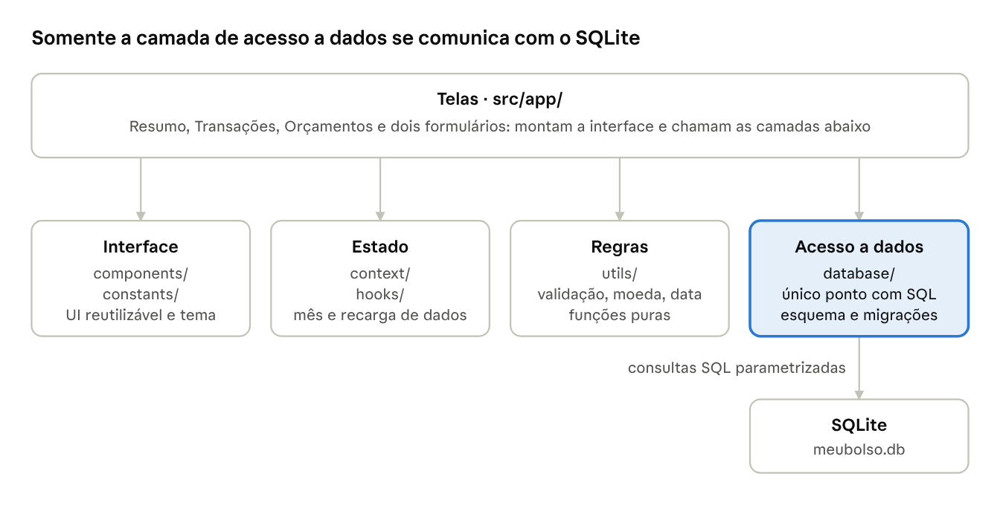

# Documentação do Aplicativo Meu Bolso

William Murcia Costa

## 1. Objetivo

O Meu Bolso é um aplicativo mobile multiplataforma para controle financeiro pessoal. Ele permite registrar receitas e despesas, acompanhar o saldo mensal, analisar a distribuição dos gastos por categoria e definir limites de gasto com alertas preventivos.

A solução adota uma abordagem *offline-first*: toda a persistência é feita em um banco SQLite embarcado no dispositivo, sem servidor, conexão com a internet ou autenticação. O projeto atende aos requisitos da atividade: interface gráfica, navegação entre telas, no mínimo três funcionalidades, validação de dados e persistência local.

Não fazem parte do escopo da versão 1.0.0 a execução na web, a sincronização em nuvem e o backup dos dados.

## 2. Tecnologias utilizadas

A aplicação é desenvolvida em TypeScript sobre React Native, com o Expo SDK 58 como plataforma de desenvolvimento e execução. As versões abaixo são as declaradas no `package.json`.

| Camada | Tecnologia | Versão | Finalidade |
| --- | --- | --- | --- |
| Plataforma | Expo | SDK 58 | Toolchain, módulos nativos e execução via Expo Go; projetos nativos gerados por Continuous Native Generation |
| Interface | React Native | 0.88 | Renderização de componentes nativos em Android e iOS |
| Interface | React | 19.3 | Componentes funcionais e hooks |
| Interface | @expo/vector-icons | 15 | Ícones Ionicons de categorias e abas |
| Linguagem | TypeScript | 6.0 | Tipagem estática em modo `strict`, com alias de importação `@/` |
| Navegação | Expo Router | 58 | Roteamento baseado em arquivos (pilha e abas), sobre o React Navigation |
| Persistência | expo-sqlite | 58 | Banco relacional SQLite embarcado, com API assíncrona |
| Qualidade | ESLint | 9 | Análise estática com `eslint-config-expo`; checagem de tipos com `tsc --noEmit` |

O Expo Router depende ainda de `react-native-screens`, `react-native-safe-area-context`, `expo-linking` e `expo-constants`.

### 2.1 Arquitetura

O código é organizado em camadas com dependência em sentido único: as telas consomem as camadas inferiores e nenhum módulo importa de `src/app/`.

Como apenas `src/database/` executa SQL, uma troca de armazenamento (por exemplo, por uma API remota) ficaria restrita a essa camada. O único estado global é o mês selecionado; os demais dados são lidos do banco sempre que a tela recebe foco, sem cache intermediário.

### 2.2 Persistência de dados

O banco `meubolso.db` é aberto pelo `SQLiteProvider` na inicialização do app. Antes da primeira tela, uma migração versionada por `PRAGMA user_version` cria o esquema e ativa o modo de journal WAL.

| Tabela | Colunas | Restrições |
| --- | --- | --- |
| `transactions` | `id`, `type`, `description`, `amount_cents`, `category`, `date`, `notes`, `created_at` | `type` restrito a `income` ou `expense`; `amount_cents > 0`; índice em `date` |
| `budgets` | `category` (chave primária), `limit_cents` | `limit_cents > 0`; gravação por upsert (`ON CONFLICT`) |

- **Valores monetários em centavos** (`INTEGER`), o que elimina erros de arredondamento de ponto flutuante.
- **Datas em ISO 8601** (`AAAA-MM-DD`), que permitem ordenação lexicográfica e filtro mensal por intervalo indexado.
- **Consultas parametrizadas** (`?`) contra SQL injection, com escape dos curingas do `LIKE` na busca textual.
- **Agregações no SQL**: o resumo do mês é calculado em uma única consulta com `SUM(CASE WHEN …)`.
- **Categorias definidas no código** (`src/constants/categories.ts`); o banco armazena apenas o identificador.

## 3. Principais funcionalidades

O app oferece quatro funcionalidades centrais, distribuídas em três abas e duas telas de formulário empilhadas sobre elas. Cada tela é uma rota do Expo Router.

| Funcionalidade | Rota | Funções de acesso a dados |
| --- | --- | --- |
| Cadastro de transações | `/transacao` e `/transacao?id=:id` | `createTransaction`, `getTransaction`, `updateTransaction`, `deleteTransaction` |
| Listagem de transações | `/transacoes` (aba) | `listTransactions` |
| Resumo mensal | `/` (aba inicial) | `getMonthSummary`, `getExpensesByCategory`, `listTransactions`, `listBudgets` |
| Orçamentos por categoria | `/orcamentos` (aba) e `/orcamento/[categoria]` | `listBudgets`, `getBudget`, `saveBudget`, `deleteBudget` |

### 3.1 Cadastro de transações

Um único formulário opera em dois modos: sem parâmetro, cria um registro; com `id`, carrega o registro para edição e permite excluí-lo após confirmação. Os campos são tipo (receita ou despesa), valor, descrição, categoria, data e observação opcional.

A data usa máscara `dd/mm/aaaa` e atalhos "Hoje" e "Ontem". Trocar o tipo limpa a categoria, pois cada tipo tem seu conjunto (9 categorias de despesa e 5 de receita). Um `id` inválido ou inexistente exibe o estado "Transação não encontrada".

### 3.2 Listagem de transações

Lista as transações do mês selecionado em ordem decrescente de data, agrupadas por dia. A busca na descrição e o filtro por tipo (Todas, Receitas, Despesas) são aplicados na consulta SQL, e a tela exibe os totais de entradas e saídas do resultado.

Os dados são recarregados sempre que a tela recebe foco (hook `useFocusData`). Respostas assíncronas obsoletas são descartadas, para que uma busca anterior não sobrescreva a atual.

### 3.3 Resumo mensal

Tela inicial com o saldo do mês, os totais de receitas e despesas e o saldo acumulado até o fim do mês. Mostra também as despesas por categoria (barras proporcionais e percentuais), as cinco transações mais recentes e os alertas de orçamento.

As quatro consultas rodam em paralelo com `Promise.all`. O mês selecionado é compartilhado entre as abas por um React Context (`MonthContext`), que bloqueia a navegação para meses futuros.

### 3.4 Orçamentos por categoria

O usuário define um limite mensal para cada categoria de despesa. O progresso (gasto do mês dividido pelo limite) é indicado por cor: verde abaixo de 80%, laranja de 80% a 100% e vermelho acima do limite.

O Resumo emite um alerta para cada categoria com uso igual ou superior a 80%, ordenando da mais excedida para a menos excedida.

### 3.5 Validação e integridade dos dados

Os dados passam por três camadas de validação antes de chegar ao banco.

| Camada | Implementação | Papel |
| --- | --- | --- |
| Entrada | `keyboardType`, `maxLength` e máscara de data nos campos | Restringe o que pode ser digitado |
| Aplicação | `validateTransaction` e `validateBudget` (`src/utils/validation.ts`) | Aplica as regras, normaliza e converte os dados (centavos, data ISO) |
| Banco | Restrições `CHECK` nas tabelas | Barreira final contra dados inconsistentes |

As funções de validação retornam uma união discriminada (`{ ok: true, value }` ou `{ ok: false, errors }`). Como as funções de gravação aceitam apenas o tipo validado, o compilador impede que dados não validados cheguem ao banco.

- **Valor:** obrigatório, maior que zero e até R$ 1.000.000,00; aceita `1.234,56`, `1234,56` e `1234.56`.
- **Descrição:** de 3 a 60 caracteres, com pelo menos uma letra; espaços excedentes são removidos.
- **Categoria:** obrigatória e compatível com o tipo escolhido.
- **Data:** deve existir no calendário, não pode ser futura e deve ser a partir de 01/01/2000.
- **Observação:** opcional, com até 200 caracteres.

As mensagens de erro aparecem abaixo de cada campo a partir da primeira tentativa de salvar.
